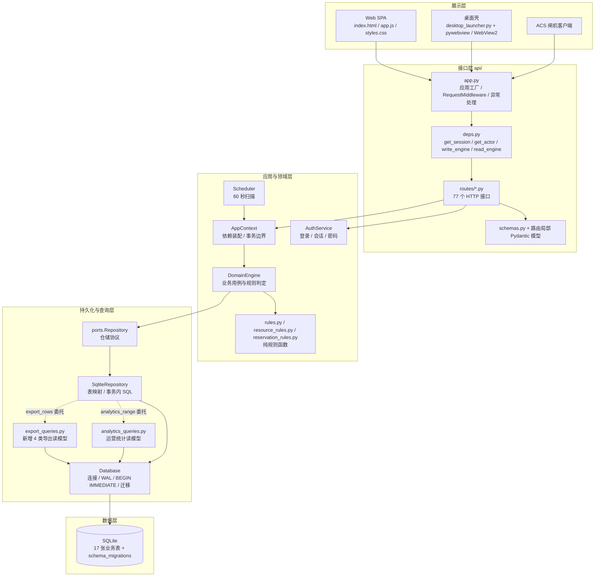
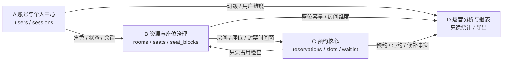
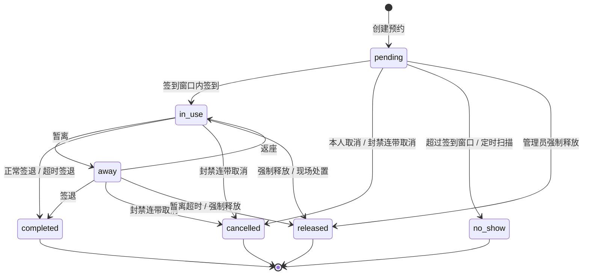
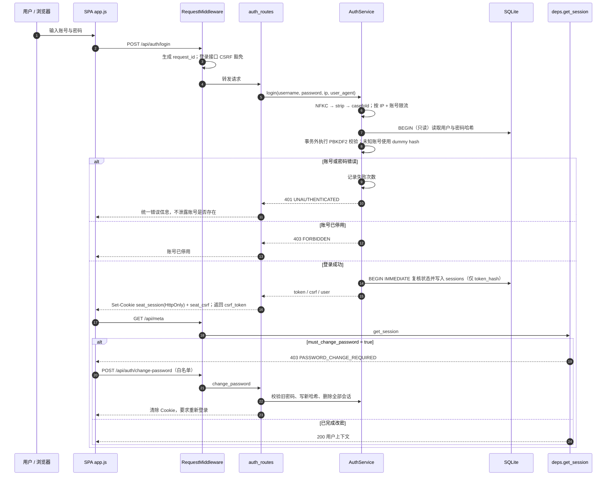
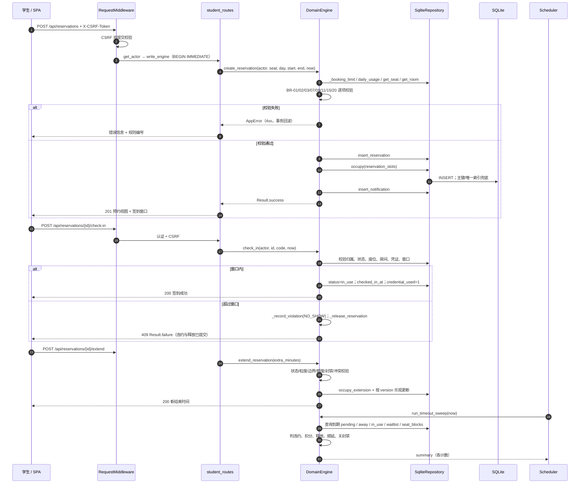
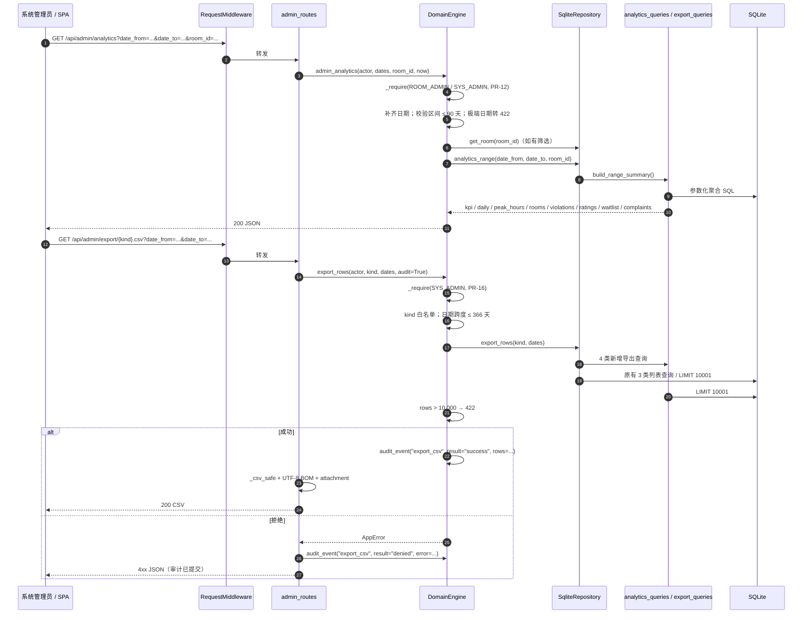
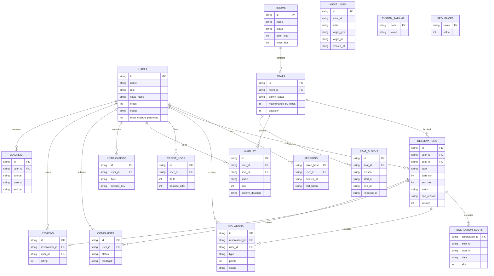
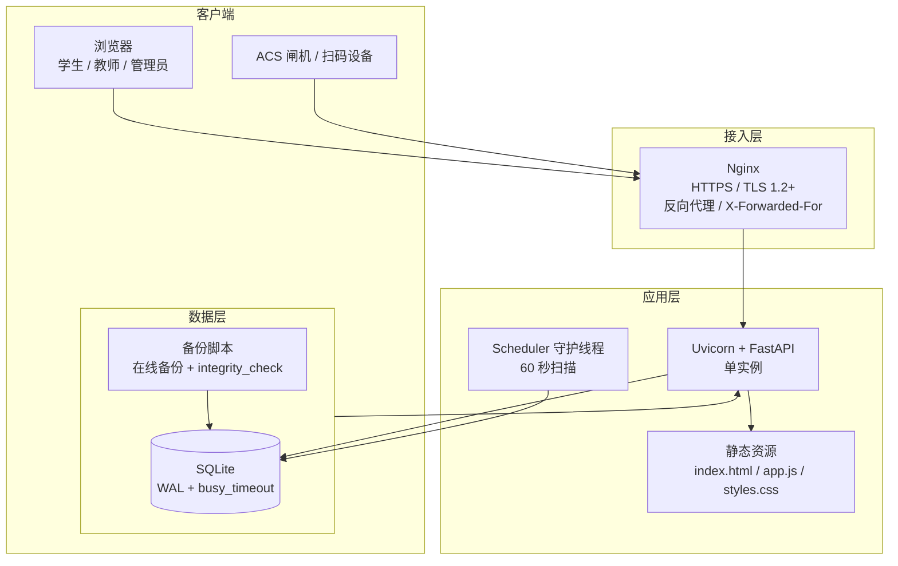

# 智慧自习室预约管理系统

## 系统架构设计报告

| 项目 | 内容 |
|---|---|
| 文档名称 | 《智慧自习室预约管理系统——系统架构设计报告》 |
| 文档版本 | V1.0 |
| 代码基线 | `integration/v1.2`，提交 `4d65f59`（v1.2-final 热修复） |
| 基线说明 | 含公共安全底座、A/B/C/D 四模块集成结果、D 模块安全整改、强制改密死锁热修复与初始管理员凭据文件 |
| 核验日期 | 2026-11-26 |
| 代码规模 | 17 张业务表；77 个已注册 HTTP 接口；`DomainEngine` 3,529 行；`SqliteRepository` 2,245 行；SPA `app.js` 3,233 行 |
| 测试基线 | `475 passed, 1 skipped`（A/B/C/D 各 25 条 + IT-01～IT-14 + IT-02B + 初始凭据 4 条；跳过项为未安装 Playwright 的浏览器端到端测试） |
| 编写依据 | 需求规格说明书 v1.2、系统说明、技术文档、架构补充说明、A/B/C/D 模块设计文档与 `4d65f59` 真实代码 |
| 核验方式 | 只读代码走查、路由注册核验、数据库迁移核验、全量测试执行；未修改被分析仓库任何文件 |

---

## 摘要

智慧自习室预约管理系统面向高校自习座位资源紧张、占座纠纷频发、人工巡检成本高、运营数据不可见等现实问题，构建了覆盖“选座—预约—签到—使用—暂离—返座—签退—违约处置—候补补位—运营分析”的完整业务闭环。系统采用单体分层架构：以原生 HTML/CSS/JavaScript 单页应用和 pywebview 桌面壳作为展示层，以 FastAPI 路由与中间件作为接口层，以 `AuthService`、`DomainEngine` 和纯规则模块作为应用与领域层，以 `SqliteRepository`、统计查询模块和导出查询模块作为持久化与查询层，以 SQLite 作为单文件数据存储。

本报告的重点不是罗列功能，而是解释系统“为什么这样分层、各层如何协作、关键业务如何穿过各层、数据如何保持一致、安全如何逐层落地”。报告给出总体分层架构图、子系统依赖图、预约状态机、登录/预约/分析导出三组时序图、ER 图和部署拓扑图，并结合 A 账号与个人中心、B 资源与座位治理、C 预约核心、D 运营分析与报表四个业务子系统，说明职责边界、关键数据结构、事务策略、并发控制与安全控制。最后给出部署形态、容量边界、演进路径和课程设计验收对照。

**关键词：** 智慧自习室；分层架构；FastAPI；SQLite；领域引擎；RBAC；CSRF；审计日志；运营分析；CSV 导出

---

## 目录

1. 引言与架构设计目标
2. 总体分层架构设计
3. 四个业务子系统设计
4. 关键业务流程时序设计
5. 数据存储与 ER 设计
6. 五层安全架构设计
7. 部署架构、并发控制与演进路线
8. 架构验收结论
附录 A 代码与架构映射
附录 B 关键规则与接口索引

---

# 1 引言与架构设计目标

## 1.1 项目背景

高校自习室长期存在“座位供给固定、需求瞬时集中、信息不透明”的矛盾。传统人工登记或口头占座方式有三个直接问题：第一，学生无法在出发前判断某间自习室是否还有座位，只能到现场碰运气；第二，座位被占用后缺乏可追溯的释放机制，管理员处理占座纠纷时缺少证据；第三，违约、投诉、封禁、信用分等治理动作分散在纸面或聊天记录中，难以形成闭环。

本项目将座位视为一种“按时段分配、可被预约、可被治理、可被统计”的资源，围绕一条主业务流程建立系统：学生选择日期、时段和座位后创建预约；在签到窗口内完成签到；使用过程中可以暂离和返座；结束时签退；超时未签到、暂离超时、超时未签退等情形由系统自动判违约并释放座位；座位被封禁或管理员强制释放时，受影响预约自动取消并通知学生；座位释放后候补队列按顺序补位；所有关键操作写入不可修改的审计日志；管理员通过运营分析页和 CSV 导出掌握整体运行状况。

## 1.2 业务痛点与架构诉求

| 业务痛点 | 具体表现 | 架构层面的诉求 |
|---|---|---|
| 座位状态不透明 | 学生不知道某时段某座位是否可用 | 座位状态必须能按“日期 + 时段”实时派生，而不是依赖人工维护的单一状态字段 |
| 同一座位被重复预约 | 两个请求同时抢占同一座位 | 预约写入必须在一个事务内完成冲突检查与时段占用，并由数据库唯一约束兜底 |
| 超时预约长期占用 | 预约后不来、暂离后不返、到点不签退 | 需要可重复执行的定时扫描，按状态机自动判违约、释放座位、顺延候补 |
| 封禁与预约相互影响 | 座位维修封禁后，已有预约如何处理 | 封禁必须有生命周期，受影响预约要批量取消且不误记违规 |
| 权限边界模糊 | 学生、教师、自习室管理员、系统管理员看到的数据不同 | 权限必须在服务端逐请求校验，数据范围按角色收敛，前端隐藏入口不能作为权限手段 |
| 运营数据不可见 | 无法回答“哪个房间利用率高、违约集中在哪些时段” | 统计查询与业务写入分离，按日期区间和房间维度聚合，指标口径可解释 |
| 安全与可追溯性不足 | 密码、会话、导出数据、审计日志缺少系统化保护 | 建立认证、会话、授权、输入防护、审计五层安全架构 |
| 部署与维护成本高 | 课程项目不宜依赖复杂中间件 | 优先单文件 SQLite、单体服务、原生前端，降低安装与演示门槛 |

## 1.3 建设目标与范围

本系统的建设目标可以概括为“一个闭环、四个角色、五个可验证”：

- **一个闭环**：预约、签到、使用、暂离、返座、签退、违约、释放、候补、通知形成闭环。
- **四个角色**：学生、教师、自习室管理员、系统管理员，各自拥有不同的功能入口和数据范围。
- **五个可验证**：业务规则可验证、权限边界可验证、并发唯一性可验证、审计可追溯可验证、导出安全可验证。

本期范围包含账号与个人中心、自习室与座位资源治理、预约主流程与候补、违约与信用、投诉与评价、运营分析与 CSV 导出、系统参数、审计日志、桌面与网页两种交付形态。以下能力明确不在本期范围：真实校园 CAS 统一身份认证、真实门禁 ACS 对接、外部短信/微信通知通道、多节点数据库集群、跨时区时间处理、讨论间成员各自签到。报告不会把需求目标写成已完成能力。

## 1.4 架构设计原则

1. **规则只实现一次。** 业务规则集中在 `domain/`，路由只做 HTTP 协议转换，仓储只做表映射，前端只做展示。修改一条规则不需要同时改五个地方。
2. **写路径统一收口。** 所有业务写操作经 `write_engine` 进入 `DomainEngine`，由 `AppContext.engine(write=True)` 开启 `BEGIN IMMEDIATE` 事务，避免“路由直接写表”造成规则遗漏。
3. **读写分离但不引入分布式复杂度。** 业务写入走领域引擎；统计与导出走独立的只读查询模块。这里采用的是“单体内部的读模型分离”，不是需要消息队列的完整 CQRS。
4. **数据库约束是最后一道防线。** 应用层做冲突检查，数据库用主键、唯一索引、外键和 CHECK 约束兜底；并发下宁可让第二条写入失败，也不允许超卖。
5. **拒绝必须无副作用。** 参数、权限、状态不允许等“纯拒绝”抛 `AppError`，事务回滚；需要“拒绝但已经产生业务后果”的场景（如超窗签到判违约）返回 `Result.failure`，由上层提交已有后果。
6. **时间显式注入。** 领域方法接收 `now`，不读系统时钟，保证测试可复现、演示可固定时间。
7. **安全默认开启。** 生产环境强制 Secure Cookie、关闭调试文档、公开健康检查最小化、导出默认审计、敏感字段默认脱敏。
8. **可部署优先。** 单机即可运行，桌面版双击可用；同时保留向 PostgreSQL、Redis、多实例演进的空间。

## 1.5 技术选型与依据

| 层次 | 选型 | 版本/形态 | 选择依据 |
|---|---|---|---|
| 后端框架 | FastAPI | 0.115.6 | 类型化路由、Pydantic 入参校验、自动 OpenAPI、依赖注入适合事务边界管理 |
| ASGI 服务器 | Uvicorn | 0.34.0 | 轻量、启动快，适合单体课程项目与桌面内嵌 |
| 数据校验 | Pydantic | 2.10.4 | 请求模型、字段长度、枚举、额外字段拒绝 |
| 存储 | SQLite（标准库 `sqlite3`） | 单文件 + WAL | 无需安装数据库服务，事务、外键、唯一索引齐全，便于备份和演示 |
| 前端 | 原生 HTML/CSS/JavaScript | ES6+，无构建链 | 无 npm、无 CDN、单文件部署，降低演示环境不确定性 |
| 桌面壳 | pywebview + WebView2 | 6.x，edgechromium 后端 | 复用系统 WebView2，不必自带 Chromium；支持无边框窗口 |
| 打包 | PyInstaller | 6.x | 生成 Windows 可执行文件，目标机无需 Python |
| 测试 | pytest + httpx + FastAPI TestClient | pytest 8.3.4 / httpx 0.28.1 | 领域单测、接口契约、权限矩阵、并发与迁移测试 |
| 时间 | 标准库 `datetime`，显式注入 | naive local datetime | 课程项目单时区部署，测试可注入固定时间 |

技术选型的核心判断是：本项目的复杂度主要来自业务规则和状态一致性，而不是高并发流量或跨团队服务治理。因此不引入微服务、消息队列、ORM 和前端框架，把复杂度集中在领域规则、事务边界和可验证性上，是更符合课程设计约束的选择。

## 1.6 术语与规则编号

| 术语 | 含义 |
|---|---|
| 预约 | 某学生在一个日期、一个连续时段内占用一个座位的行为 |
| 时段（slot） | 以 30 分钟为粒度的最小调度单位，一天最多 48 个 slot |
| 占用 | 预约在 `reservation_slots` 中写入对应座位、日期、slot 的记录 |
| 派生座位状态 | 不单独存储，由当前时间、预约状态和封禁时间窗实时计算出的座位状态 |
| 封禁 | 管理员对座位在某个时间窗内设置不可用的治理记录 |
| 候补 | 目标时段已满时排队，座位释放后按顺序通知确认 |
| 信用分 | 0～100 的治理分值，违约扣分、按时履约奖励，低于阈值限制预约 |
| 审计事件 | 记录操作者、动作、对象、前后值、时间、来源 IP 的不可修改日志 |
| BR / PR / ST | 业务规则 / 权限规则 / 状态规则编号，代码中通过 `@implements` 或错误 `rule` 字段追溯 |

---

# 2 总体分层架构设计

## 2.1 架构总览

系统采用“展示层—接口层—应用与领域层—持久化与查询层—数据层”的五层结构。下图中的实线表示调用或依赖方向，虚线表示读模型委托关系。



这张图表达了三个关键约束：

- **展示层不能直接访问数据库。** 浏览器只通过 `/api` 下的 HTTP 接口访问服务端；桌面壳只是把同一套 SPA 装进 WebView2，不额外开后门。
- **接口层不能承载业务规则。** 路由负责解析参数、获取身份、开启事务、把结果渲染为 HTTP；真正的规则判定在 `DomainEngine` 和纯规则模块中。
- **写路径与统计路径在持久化层分叉。** 业务写入经 `SqliteRepository`；运营统计经 `analytics_queries.py`；新增导出经 `export_queries.py`。三者共享同一个数据库连接和事务上下文，但不互相污染职责。

## 2.2 展示层设计

### 2.2.1 单页应用结构

前端是一个不使用框架和构建工具的 IIFE 单页应用，核心文件为：

- `web/index.html`：登录页、应用外壳、导航、视图容器、弹窗容器；
- `web/styles.css`：设计令牌、布局、组件、响应式断点和打印样式；
- `web/app.js`：状态、HTTP 客户端、路由、视图函数、事件委托和业务交互。

`app.js` 采用集中式 `state` 对象保存当前用户、元数据、CSRF 令牌、当前视图、筛选条件、分页、弹窗状态等。页面通过 hash 路由切换，`NAV`、`VIEW_META`、`VIEWS`、`AFTER`、`ACTIONS` 是共享注册表：导航决定“谁能看到什么入口”，视图函数决定“这个页面渲染什么”，`ACTIONS` 决定“按钮点击后调用哪个处理函数”。

```text
用户点击导航
  → location.hash = "#/view"
  → hashchange
  → activate(view)
  → 校验 allowedViews()
  → renderNav() + 设置标题
  → renderView()
  → VIEWS[view]() 拉取数据并返回 HTML
  → AFTER[view]() 绑定图表/定时刷新
```

### 2.2.2 HTTP 客户端与 CSRF 注入

所有业务请求统一经过 `api(path, options)` 封装：

1. 拼接 `/api` 前缀与查询参数；
2. 非 GET 请求自动从 `state.csrf` 或 `seat_csrf` Cookie 读取令牌，写入 `X-CSRF-Token` 请求头；
3. 使用 `credentials: 'same-origin'` 携带会话 Cookie；
4. 统一解析 `{ok, data, message}` 或 `{ok:false, error}`；
5. 遇到 401 时统一回到登录页，但登录接口自身的 401 保留“账号或密码不正确”的原始语义。

这种设计的目的是让业务视图不需要逐处处理 CSRF、401 和错误提示。前端隐藏管理入口只是体验优化，真正的权限仍由后端逐请求校验。

### 2.2.3 视图与角色

前端导航按角色分组：

| 角色 | 主要视图 |
|---|---|
| 学生 | 找座位、我的预约、信用、反馈、消息 |
| 教师 | 班级看板（仅汇总） |
| 自习室管理员 | 概览、分析、现场、资源、预约查询、投诉、评价、违规申诉、学生 |
| 系统管理员 | 分析、参数、资源、账号、审计、系统 |

视图函数只负责展示，不自行判断业务规则。例如“能否签到”由后端返回的预约状态、时间和窗口决定，前端最多根据状态隐藏按钮；即使有人手动构造请求，后端仍会拒绝。

## 2.3 接口层设计

### 2.3.1 应用工厂与路由装配

`api/app.py` 的 `create_app()` 是唯一应用装配入口：

```python
app.include_router(common_routes.router, prefix="/api")
app.include_router(auth_routes.router, prefix="/api")
app.include_router(student_routes.router, prefix="/api")
app.include_router(admin_routes.router, prefix="/api")
app.include_router(account_routes.router, prefix="/api")
app.include_router(resource_routes.router, prefix="/api")
```

六个 router 共注册 77 个 HTTP 接口。按职责分布为：公共接口 5 个、认证接口 5 个、学生接口 25 个、管理接口 30 个、账号接口 8 个、资源治理接口 4 个。路由文件按角色和资源边界拆分，避免单个文件无限膨胀。

应用工厂同时完成：

- 配置校验：`settings.validate()` 防止调用方绕过生产环境检查；
- 日志初始化：`configure_logging`；
- 生命周期管理：启动时迁移数据库、启动后台调度器，关闭时停止调度器；
- 异常处理：`AppError`、`RequestValidationError`、`sqlite3.OperationalError`、未捕获异常分别映射为稳定的 JSON 错误；
- 静态资源：`/static`、`/`、`/favicon.svg`；
- 生产环境关闭 `/docs`、`/redoc`、`/openapi.json`。

### 2.3.2 中间件与安全响应头

`RequestMiddleware` 是每个请求进入业务前的统一关卡：

1. 生成或复用 `X-Request-ID`，写入日志上下文；
2. 对非 GET 的 `/api/` 请求执行 CSRF 双提交校验，登录接口和 `/api/acs/*` 豁免；
3. 响应统一添加 `X-Content-Type-Options: nosniff`、`X-Frame-Options: DENY`、`Referrer-Policy: no-referrer`、`Permissions-Policy` 和 CSP；
4. 所有 `/api/` 响应设置 `Cache-Control: no-store`，避免敏感数据被浏览器缓存；
5. 记录方法、路径、状态码、耗时，但不记录请求体和凭据。

CSRF 校验使用常量时间比较：

```python
cookie = request.cookies.get(self.settings.csrf_cookie_name)
header = request.headers.get("X-CSRF-Token")
return not constant_time_equals(cookie, header)
```

失败返回 403 `CSRF_FAILED`，前端提示刷新页面后重试。

### 2.3.3 依赖注入与事务边界

`api/deps.py` 把“身份、权限前置条件、事务、响应格式”从路由中抽出来：

| 依赖 | 作用 |
|---|---|
| `get_context` | 从 `app.state.ctx` 取得 `AppContext` |
| `get_session` | 读取 `seat_session` Cookie，调用 `AuthService.authenticate`，校验强制改密门禁 |
| `get_actor` | 把 `User` 转为领域层 `Actor`（只保留 id、姓名、角色、班级、院系） |
| `client_ip` | 默认取直连地址；只有显式开启 `SEAT_TRUST_PROXY` 才信任 `X-Forwarded-For` |
| `write_engine` | 开启 `BEGIN IMMEDIATE` 写事务，产出 `DomainEngine`，请求结束提交或回滚 |
| `read_engine` | 开启只读事务，产出 `DomainEngine` |
| `success` / `render` / `render_page` | 统一成功、业务拒绝、分页响应格式 |

这里有一个重要的架构约定：**路由不通过抛业务异常来表达“业务结果失败”**。`Result.failure` 会被 `render()` 渲染为 409，但事务正常提交，从而保留引擎已经写入的后果（例如超窗签到已经判违约、释放座位）。只有参数、权限、状态不允许等“纯拒绝”才抛 `AppError`，让事务回滚，保证“拒绝无副作用”。

强制改密门禁也在这一层实现：

```python
_PASSWORD_CHANGE_ALLOWED = frozenset(
    {"/api/auth/me", "/api/auth/change-password", "/api/auth/logout"}
)
```

当 `session.user.must_change_password` 为真时，除上述三个接口外，所有请求返回 403 `PASSWORD_CHANGE_REQUIRED`。这样即使前端被绕过，服务端也不会允许未改密账号继续访问业务。

### 2.3.4 错误模型

`errors.py` 定义了稳定的错误层次：

| 异常 | HTTP | code | 典型场景 |
|---|---|---|---|
| `ValidationFailed` | 422 | `VALIDATION_ERROR` | 参数形状、日期跨度、字段长度不合法 |
| `Unauthenticated` | 401 | `UNAUTHENTICATED` | 未登录、会话失效 |
| `Forbidden` | 403 | `FORBIDDEN` | 角色不符、数据范围不符、强制改密 |
| `NotFound` | 404 | `NOT_FOUND` | 预约、座位、账号不存在 |
| `Conflict` | 409 | `CONFLICT` | 座位时段冲突、并发版本冲突 |
| `RuleViolation` | 400 | `RULE_VIOLATION` | 违反 BR/PR/ST 规则 |
| `RateLimited` | 429 | `RATE_LIMITED` | 登录失败次数过多 |
| `InternalError` | 500 | `INTERNAL_ERROR` | 未预期异常 |

每个错误可以携带 `rule` 字段，前端直接展示规则编号，验收人员可以据此追溯到需求条目。

## 2.4 应用与领域层设计

### 2.4.1 AuthService：认证与会话

`AuthService` 负责登录、会话认证、登出、修改密码、清理过期会话和重置密码。它不直接处理 HTTP，也不关心页面如何展示。其关键设计是：

- 用户名统一规范化：NFKC → strip → casefold，查询与限流 key 使用同一结果；
- 登录限流：同一 IP + 账号 5 分钟内失败 5 次，锁定 5 分钟；限流器有容量上限和清理策略，容量满时对新 key fail-closed；
- 密码校验：先只读事务取哈希，事务外执行 PBKDF2，避免把 260,000 轮哈希放进 SQLite 写锁；
- 会话写入：复核账号状态后，在写事务中创建会话，单账号最多保留 5 个活跃会话；
- 会话认证：每个请求只读事务查会话摘要，校验绝对过期、空闲过期和账号状态；滑动续期是尽力而为，失败不阻断业务；
- 修改密码：校验旧密码、写新哈希、清除 `must_change_password`、删除该账号全部会话。

### 2.4.2 AppContext：依赖装配与事务工厂

`AppContext` 是应用级容器，持有 `Settings`、`Database`、`AuthService`、`Scheduler` 和启动时间。它的核心方法是：

```python
@contextmanager
def engine(self, *, write: bool = True) -> Iterator[DomainEngine]:
    with self.db.transaction(write=write) as conn:
        repo = SqliteRepository(conn)
        yield DomainEngine(repo, repo.load_params())
```

这段代码把“一个用例 = 一个事务 = 一个引擎实例”固定下来。路由不需要自己 `commit` 或 `rollback`；异常向上传播时由 `Database.transaction` 统一回滚。`DomainEngine` 只依赖 `ports.Repository` 协议，不依赖具体 SQLite 实现，为未来替换 PostgreSQL 留下接口。

### 2.4.3 DomainEngine：业务用例的唯一实现处

`DomainEngine` 是领域层的核心，包含预约、签到、暂离、返座、签退、取消、续约、候补、封禁、强制释放、违约、信用、投诉、评价、参数、账号、资源、统计和导出等用例。它的设计特点：

- **规则判定集中**：每个用例先做 `_require` 权限检查，再按业务顺序校验，错误带 `rule` 编号；
- **辅助方法冻结**：`_require`、`_user`、`_view`、`_reservation`、`_own_reservation`、`_audit`、`_notify`、`_credit_delta`、`_refresh_limit`、`_apply_blacklist`、`_booking_limit`、`_record_violation`、`_release_reservation`、`_offer_waitlist`、`_expire_waitlist` 等是跨模块共享的稳定契约；
- **时间注入**：所有用例接收 `now`，不读系统时钟；
- **审计统一**：既有写路径使用 `_audit` 记录动作、对象、前后值和 IP；新增共享导出等场景使用 `audit_event`，自动递归脱敏；
- **领域事件副作用**：预约成功、违约、候补、封禁取消、管理员释放等通过 `_notify` 写站内通知，通知去重键避免重复提醒。

### 2.4.4 纯规则模块

`domain/rules.py`、`domain/resource_rules.py`、`domain/reservation_rules.py` 存放无 I/O、不读系统时钟的纯函数。它们的好处是：

- 可以独立单元测试，不需要数据库；
- 规则组合清晰，例如 `seat_state_after_block` 只根据座位状态、封禁记录和当前时间返回目标状态；
- 引擎只负责“按什么顺序调用规则、失败时抛什么错误”，不把判断逻辑散落在 SQL 或路由中。

典型函数包括：

| 模块 | 代表函数 | 作用 |
|---|---|---|
| `rules.py` | `validate_slot_range`、`checkin_window`、`checkin_phase`、`cancel_phase`、`quota_exceeded`、`clamp_credit`、`seat_state_from_reservation` | 预约时长、签到窗口、取消阶段、额度、信用分、座位状态派生 |
| `resource_rules.py` | `seat_state_after_block`、`seat_state_after_blocks_closed`、`can_restore_seat`、`bulk_limit_violation`、`duplicate_ids` | 封禁生命周期、批量建座、座位移动保护 |
| `reservation_rules.py` | `extension_state_error`、`extension_minutes_error`、`extension_bounds_error`、`extension_quota_error`、`waitlist_cancel_state_error` | 续约状态、粒度、边界、额度，候补取消状态 |

## 2.5 持久化与查询层设计

### 2.5.1 Database：连接、事务与迁移

`storage/database.py` 统一管理 SQLite 连接和事务：

- `PRAGMA foreign_keys = ON`：启用外键；
- `PRAGMA journal_mode = WAL`：读写并发，写事务排队；
- `PRAGMA synchronous = NORMAL`：在 WAL 下兼顾安全与性能；
- `PRAGMA busy_timeout = 5000`：写锁冲突时等待而不是立刻报错；
- 写事务统一 `BEGIN IMMEDIATE`：先拿写锁再检查冲突，避免“两个事务都读到可用、然后都写”的竞态；
- 读事务使用 `BEGIN`：鉴权、列表、统计等高频路径不占写锁；
- `migrate()` 在一个写事务内按版本顺序执行未应用迁移，并把版本写入 `schema_migrations`，重复调用返回空列表，保证幂等。

### 2.5.2 SqliteRepository：表映射与事务内 SQL

`SqliteRepository` 承担三类职责：

1. **行到实体的映射**：`_user`、`_room`、`_seat`、`_reservation`、`_violation`、`_waitlist`、`_complaint`、`_review`、`_seat_block` 等；
2. **写操作**：`save_user`、`save_seat`、`insert_reservation`、`occupy`、`update_reservation`、`insert_audit` 等；
3. **查询操作**：`seat_views`、`list_reservations`、`daily_usage`、`find_seat_conflict`、`list_active_overlapping`、`analytics_range`、`export_rows` 等。

仓储不判断权限、不决定业务状态，只执行 SQL 和必要的唯一约束冲突转译。例如 `occupy()` 捕获 `sqlite3.IntegrityError` 并抛出 `SlotConflict`，由引擎转换为 409 `CONFLICT`。

### 2.5.3 analytics_queries：运营统计读模型

`storage/analytics_queries.py` 只做按日期区间和房间维度的只读统计，不判断权限、不校验日期、不格式化 CSV。`build_range_summary()` 返回：

- `range`：日期区间、天数、房间；
- `kpi`：预约数、完成数、违约数、取消数、释放数、签到率、完成率、未签到率、取消率、平均时长、平均评分、投诉办结率、候补等待数、座位总数；
- `daily`：每日预约、完成、违约、取消、释放、签到趋势；
- `peak_hours`：按开始时段聚合的高峰分布；
- `rooms`：房间排名与预约时段利用率；
- `violations`：违约类型与趋势；
- `ratings`：评分分布；
- `waitlist`：候补漏斗；
- `complaints`：投诉处理与平均时长。

它的关键口径是：**预约时段利用率使用 `reservations` 的时段长度计算，不使用 `reservation_slots`**。因为 `reservation_slots` 只代表当前占用，已完成或已释放预约的历史 slot 会被删除，不能用于历史区间统计。这一点在 `METRIC_NOTES` 中明确写给用户，避免把“预约资源占用率”误解为“实际在座使用率”。

### 2.5.4 export_queries：新增导出读模型

`storage/export_queries.py` 只负责新增的 4 类导出：投诉、黑名单、信用流水、候补。原有 3 类（预约、违规、审计）继续复用 `SqliteRepository` 的列表方法。所有查询使用 `LIMIT 10001` 作为“多取一行”的超限探测，超过 10,000 行由引擎拒绝，不静默截断。

导出查询不做权限判断、不做 CSV 转义。权限在 `DomainEngine.export_rows`，转义在 `admin_routes._csv_safe`，职责边界清晰。

## 2.6 写入路径与读取路径分离

系统没有引入完整 CQRS，但在单体内部做了“写模型 / 读模型”分离：

| 路径 | 入口 | 事务 | 主要组件 | 输出 |
|---|---|---|---|---|
| 业务写入 | POST/PUT/DELETE | `BEGIN IMMEDIATE` | `write_engine` → `DomainEngine` → `SqliteRepository` | 业务结果 + 审计 + 通知 |
| 单对象读取 | GET（业务详情） | `BEGIN` | `read_engine` → `DomainEngine` → `SqliteRepository` | 领域视图 |
| 运营统计 | GET `/admin/analytics` | `BEGIN` | `admin_analytics` → `repository.analytics_range` → `analytics_queries` | KPI + 趋势 + 排名 |
| CSV 导出 | GET `/admin/export/{kind}.csv` | `BEGIN IMMEDIATE` | `export_rows` → `repository.export_rows` → `export_queries` / 列表方法 | CSV 文件 + 审计 |

为什么导出使用写事务？因为导出成功或拒绝都要写审计日志。`write_engine` 让审计记录和导出查询在同一个事务中完成，拒绝时也能正常提交审计，而不是因为抛异常把“拒绝留痕”回滚掉。

## 2.7 横切关注点

| 横切关注点 | 实现位置 | 设计要点 |
|---|---|---|
| 配置 | `config.py` | 启动时解析一次，运行期不可变；非法配置直接拒绝启动 |
| 日志 | `logging_setup.py` | 请求 ID、任务上下文、JSON 可选；不记录密码/令牌 |
| 错误 | `errors.py` | 稳定 code + rule + details，前端可判断、验收可追溯 |
| 审计 | `DomainEngine._audit` / `audit_event` | 追加写；敏感字段递归脱敏；拒绝也留痕 |
| 通知 | `_notify` | 站内消息；`dedupe_key` 去重；类型化 |
| 时间 | `timeutil.py` + `now` 注入 | 领域层不读系统时钟；slot 与 datetime 双向换算 |
| 权限 | `_require` + 数据范围过滤 | 服务端逐请求；前端隐藏不作为权限 |
| 事务 | `AppContext.engine` + `Database.transaction` | 一用例一事务；异常回滚；拒绝无副作用 |

## 2.8 关键架构决策

| 编号 | 决策 | 备选方案 | 选择理由 | 代价 |
|---|---|---|---|---|
| ADR-01 | 单体分层架构 | 微服务 | 课程项目团队小、部署环境简单；单体减少网络与运维复杂度 | 模块边界靠代码纪律，不能靠进程隔离 |
| ADR-02 | SQLite + WAL | PostgreSQL/MySQL | 零安装、单文件、备份简单、事务与唯一约束足够 | 单写者、横向扩展受限 |
| ADR-03 | 原生 SPA | React/Vue + 构建链 | 无 npm/CDN，演示稳定，部署只需静态文件 | 大型页面复用能力弱，需要自律的视图函数组织 |
| ADR-04 | DomainEngine 集中规则 | 路由/服务/仓储各自判断 | 规则只实现一次，验收可追溯 | 引擎较大，需要分区和冻结辅助方法 |
| ADR-05 | 统计查询独立读模型 | 全部塞进 Repository | 统计 SQL 复杂、口径独立，分离后易测试 | 需要维护两套查询入口 |
| ADR-06 | 服务端强制安全门禁 | 仅前端控制 | 防绕过；强制改密、权限、CSRF 都在服务端 | 前端需要处理 403 分支 |

## 2.9 跨模块安全契约

| 契约 | 统一口径 | 主要落点 |
|---|---|---|
| M-04 资源不可用释放 | `release_affected_reservations(room_id, seat_id, reason, actor, now)`；预约 `cancelled` + `end_reason="resource_unavailable"`；不 `no_show`、不扣信用 | B 的 `update_room`/`update_seat`、C 的 `run_timeout_sweep` |
| M-03 强制改密 | `must_change_password=true` 时业务 API 统一 403 `PASSWORD_CHANGE_REQUIRED`；仅白名单 `/api/auth/me`、`/api/auth/change-password`、`/api/auth/logout` | `api/deps.py` 公共底座；A 只回归 |
| L-01 账号列表 | `room_admin` 默认且仅查询学生，非学生 role 返回 403 `PR-18`；返回 `id/name/role/role_label/department/class_name/status`；`sys_admin` 全量 | `engine.list_users`、`admin_routes.list_users` |
| L-04 / L-06 / L-09 / L-10 | 7 类 CSV 统一 `_csv_safe`；导出成功/拒绝均审计；分析 90 天、导出 366 天/10,000 行；通知 `ids` 最多 100 条 | `admin_routes`、`export_queries.py`、`common_routes.py` |
| 数据库迁移 | v1 初始表、v2 封禁生命周期、v3 审计预留、v4 `resource_constraints`；当前 `LATEST_MIGRATION_VERSION=4` | `storage/migrations.py` |

---

# 3 四个业务子系统设计

## 3.1 子系统划分与依赖

系统按业务能力划分为 A、B、C、D 四个子系统。划分不是按技术层切，而是按“谁拥有数据、谁负责状态迁移、谁只读消费”切。



| 子系统 | 核心职责 | 主要数据表 | 主要代码位置 |
|---|---|---|---|
| A 账号与个人中心 | 登录、会话、强制改密、账号创建/启停/重置、个人资料、登录设备、我的候补 | `users`、`sessions` | `account_routes.py`、`engine.py` 账号区、`repository.py` 用户/会话区、`app.js` 账号/个人中心 |
| B 资源与座位治理 | 自习室/座位增改停用、批量建座、封禁生命周期、按记录解封、停用影响预览、座位移动保护 | `rooms`、`seats`、`seat_blocks` | `resource_rules.py`、`resource_routes.py`、`engine.py` 资源区、`repository.py` 座位/封禁区、`migrations.py` v2/v4 |
| C 预约核心 | 创建预约、签到、暂离、返座、签退、取消、续约、候补、超时扫描、违约/信用 | `reservations`、`reservation_slots`、`waitlist`、`violations`、`credit_logs`、`notifications` | `engine.py` 预约/候补区、`reservation_rules.py`、`student_routes.py`、`repository.py` 预约/候补区 |
| D 运营分析与报表 | 任意区间分析、KPI、趋势、排名、7 类 CSV 导出 | 只读消费上述业务表 | `analytics_queries.py`、`export_queries.py`、`engine.py` 统计/导出区、`admin_routes.py` 分析/导出区、`app.js` 分析页 |

## 3.2 A 子系统：账号与个人中心

### 3.2.1 职责与接口

A 子系统负责“人”的生命周期，不负责预约和座位规则。它提供 8 个接口：

| 方法与路径 | 权限 | 作用 |
|---|---|---|
| `POST /api/admin/users` | 系统管理员 | 创建账号，返回用户与一次性初始密码 |
| `PUT /api/admin/users/{id}/status` | 系统管理员 | 启用/停用账号，必须填写原因 |
| `POST /api/admin/users/{id}/reset-password` | 系统管理员 | 重置密码，返回一次性初始密码 |
| `GET /api/admin/users/{id}/sessions` | 系统管理员 | 查看账号登录设备 |
| `POST /api/admin/users/{id}/sessions/revoke` | 系统管理员 | 注销账号全部设备 |
| `GET /api/me/sessions` | 任意登录用户 | 查看本人登录设备 |
| `POST /api/me/sessions/revoke-others` | 任意登录用户 | 退出其他设备，保留当前会话 |
| `PUT /api/me/profile` | 任意登录用户 | 修改本人姓名/院系 |

### 3.2.2 账号状态与强制改密

账号状态为 `active` / `disabled`。停用立即删除该账号全部会话，已有预约、违规、信用记录保留；重新启用不恢复旧会话，必须重新登录。系统禁止停用自己，也禁止停用最后一名启用中的系统管理员，避免把系统锁死。

创建账号和重置密码都会设置 `must_change_password=true`。用户下次登录后，`deps.get_session` 会拦截除 `/api/auth/me`、`/api/auth/change-password`、`/api/auth/logout` 之外的所有请求，返回 403 `PASSWORD_CHANGE_REQUIRED`。改密成功后，服务端删除该账号全部会话并清除 Cookie，要求使用新密码重新登录。

这个设计把“初始密码只展示一次”和“首次登录必须改密”连成闭环：管理员创建账号时只在响应中返回一次初始密码，用户列表、审计日志和浏览器持久存储都不保存明文；用户首次登录必须改密，改密后旧会话全部失效。

### 3.2.3 会话设备管理

会话列表只返回 `created_at`、`last_seen_at`、`expires_at`、`ip`、`user_agent`、`current`。`current` 是布尔值，不是会话标识；条目不返回 token、摘要或 CSRF。服务端会过滤已经超过绝对有效期或空闲有效期的会话，避免展示“看起来还活着、实际已失效”的记录。

“退出其他设备”保留当前会话，依赖 `get_session` 提供的当前 token 摘要，不接受用户传入的“保留哪个会话”，防止越权保留他人会话。

### 3.2.4 审计

A 子系统的审计动作包括：`user_create`、`user_status_change`、`user_reset_password`、`session_revoke`、`profile_update`。记录操作者、目标、必要的前后状态和来源 IP，不记录凭据。

## 3.3 B 子系统：资源与座位治理

### 3.3.1 资源模型与派生座位状态

B 子系统拥有 `rooms`、`seats`、`seat_blocks` 三张表，负责自习室和座位的增改停用、批量建座、封禁生命周期、停用影响预览和座位跨自习室移动保护。

座位有两类状态，必须区分：

- **管理状态** `seats.admin_status`：`available` / `maintenance` / `disabled`，表示资源本身是否被管理员启用、维护或停用；
- **派生状态** `SeatState`：`available` / `reserved` / `occupied` / `held` / `maintenance` / `disabled`，表示“某日期某时段”的实时可用性。

派生状态不单独存储，由 `SqliteRepository.seat_views()` 根据以下因素计算：

1. 座位管理状态：`disabled` 直接派生为 `disabled`；
2. 维护状态或封禁时间窗覆盖查询区间：派生为 `maintenance`；
3. 该座位在查询时段内有预约：按预约状态映射为 `reserved` / `occupied` / `held`；
4. 否则为 `available`。

这样设计避免“预约状态变了，座位状态表没更新”的双写不一致问题。座位状态永远可以从事实表重新推导。

### 3.3.2 封禁生命周期

封禁不是简单地把 `admin_status` 改成 `maintenance`，而是一条有生命周期的记录。`seat_blocks` 保存 `reason`、`start_at`、`end_at`、`created_by`、`created_at`、`released_at`。`seats.maintenance_by_block`（v2 迁移新增）表示“当前维护状态是否由封禁流程设置”：

| 值 | 含义 |
|---|---|
| `1` | 维护状态由封禁流程设置，封禁到期/释放时可以自动恢复为 `available` |
| `0` | 手工维护 / 停用 / 正常，任何封禁到期都不得自动恢复 |

新增封禁时的状态迁移由 `resource_rules.seat_state_after_block()` 决定：

| 座位初始状态 | 封禁窗口 | 结果 `admin_status` | 结果 `maintenance_by_block` | 说明 |
|---|---|---|---|---|
| `available` | 覆盖当前时刻 | `maintenance` | `1` | 立即进入维护 |
| `available` | 未来 | `available` | `1` | 当前不变，维护态由时间窗派生 |
| `available` | 已过去 | `available` | `1` | 记录仍会被下次扫描关闭 |
| `maintenance` + 标记 `0` | 任意 | `maintenance` | `0` | 人工维护优先，不写标记 |
| `maintenance` + 标记 `1` | 覆盖当前时刻 | `maintenance` | `1` | 继续由封禁管理 |
| `maintenance` + 标记 `1` | 未来 | `maintenance` | `1` | 到期后再处理 |
| `disabled` | 任意 | `disabled` | `0` | 封禁只通过时间窗生效，绝不允许到期变 `available` |

封禁关闭后的状态迁移由 `seat_state_after_blocks_closed()` 决定：

| 条件 | 结果 |
|---|---|
| 仍有其他未释放封禁 | 维持现状，不提前恢复 |
| 标记 `1` 且 `admin_status='maintenance'` | `available` + 标记归零 |
| `disabled` | 保持 `disabled`，标记归零 |
| `available` | 保持 `available`，标记归零 |
| 手工维护（标记 `0`、`maintenance`） | 保持 `maintenance`，标记 `0` |

两个入口的行为差异是刻意的：

- **定时扫描到期**：客观时间驱动，封禁管理的维护可以自动恢复；
- **按座位整体解封**（`DELETE /admin/seat-blocks/{seat_id}`）：语义是“解封该座位”，兼容既有行为；
- **按记录解封**（`POST /admin/seat-blocks/{block_id}/release`）：默认只关闭指定记录，不改座位状态；只有显式 `restore_seat=true` 且满足“封禁管理 + 无其他未释放封禁”才恢复。停用座位即使传 `restore_seat=true` 也会被拒绝，必须走座位管理显式启用。

### 3.3.3 封禁与预约的联动

封禁创建后，B 子系统会查询与该封禁时间窗重叠的有效预约（`pending`、`in_use`、`away`），逐条调用 C 的 `_release_reservation()`，将预约置为 `cancelled`，`end_reason` 记为 `seat_blocked`，并给学生发站内通知。受影响预约**不记违规、不扣信用分**，这是 BR-09 的关键语义：资源不可用不是学生的过错。

资源状态变更（关闭房间、座位停用/维护）使用另一条独立契约：B 的 `update_room(cascade_release=True)` / `update_seat(cascade_release=True)` 在同一写事务内调用 `release_affected_reservations(room_id, seat_id, reason, actor, now)`，受影响预约统一置为 `cancelled`、`end_reason="resource_unavailable"`，不记 `no_show`、不扣信用。C 的 `run_timeout_sweep` 只读识别资源不可用预约并复用同一语义，避免把管理员关闭资源误判成学生未签到。封禁取消仍保留 `seat_blocked`，与资源停用取消的 `resource_unavailable` 区分。

### 3.3.4 批量建座与停用影响预览

批量建座 `POST /api/admin/seats/bulk` 单次最多 100 个座位，要求：

- 房间存在；
- 座位编号非空、批内不重复、全库不重复；
- 座位类型与容量合法（讨论间 4～8 人，其他容量必须为 1）；
- 任一条失败则整批回滚，不允许“成功一半”。

实现方式是逐条 `save_seat()`，任一条抛 `AppError` 后由外层写事务整体回滚。这依赖“先写后抛异常 → 回滚”的机制，测试中有专门的 `test_bulk_create_seats_rolls_back_on_invalid_item` 断言。

停用影响预览 `GET /api/admin/rooms/{room_id}/impact` 是只读接口，按 `pending`、`in_use`、`away` 三种状态统计关闭自习室会影响多少预约，并返回前 20 条预览；预览本身不产生副作用。真正执行关闭时，`update_room(cascade_release=True)` 会在同一写事务内取消受影响预约，取消原因统一为 `resource_unavailable`。

座位跨自习室移动保护：当座位存在 `pending`、`in_use`、`away` 预约时，`PUT /api/admin/seats/{id}` 拒绝改写 `room_id`，返回 409 `PR-05`，避免历史预约的房间归属被改写。

### 3.3.5 v2 / v4 迁移与升级安全

v2 迁移解决封禁生命周期：

```sql
ALTER TABLE seats ADD COLUMN maintenance_by_block INTEGER NOT NULL DEFAULT 0;
```

它**只加列、不回填**。原因是 v1 没有记录“维护来源”，无法区分“管理员手工设为维护”和“旧封禁流程设为维护”。如果按 `admin_status='maintenance'` 回填 `1`，升级后一次旧封禁到期就可能把人工维护的座位误恢复成可预约。零回填的代价是升级后需要一次性人工核对历史维护座位，收益是绝不会误恢复。

v4 迁移（`resource_constraints`）补齐资源/预约约束：

- `reservation_slots` 的 `seat_id/user_id` 必须与父预约一致（触发器）；
- `waitlist` 重建并增加 `start_slot 0..47`、`end_slot 1..48`、`end_slot > start_slot`；
- `complaints` 的 `seat_id/reservation_id` 改为可空外键；
- 迁移前清理越界 slot、孤儿外键，旧库 v2→v4 升级测试通过。

迁移执行器 `Database.migrate()` 在一个 `BEGIN IMMEDIATE` 事务内按版本顺序执行未应用迁移，并写入 `schema_migrations`；重复调用返回空列表。当前 `LATEST_MIGRATION_VERSION=4`；v3 保留给共享层审计，v4 为资源约束，只增不减，不得复用。

## 3.4 C 子系统：预约核心

### 3.4.1 预约状态机

预约有 7 个状态，其中 4 个终态不可再变更：



| 状态 | 中文 | 进入条件 | 是否终态 |
|---|---|---|---|
| `pending` | 待签到 | 创建预约成功 | 否 |
| `in_use` | 使用中 | 签到窗口内签到 | 否 |
| `away` | 暂离 | 使用中发起暂离 | 否 |
| `completed` | 已完成 | 正常签退或超时签退 | 是 |
| `cancelled` | 已取消 | 本人取消、封禁连带取消 | 是 |
| `no_show` | 已违约 | 超过签到窗口未签到 | 是 |
| `released` | 已释放 | 管理员强制释放、暂离超时、现场处置 | 是 |

终态预约可由 `prune` 子命令按保留策略清理，但在线业务不物理删除。

### 3.4.2 创建预约：一个事务内的完整校验链

`create_reservation` 的校验顺序是固定的，先便宜后昂贵、先权限后资源：

1. 角色必须是学生（PR-02）；
2. 账号必须启用，且不处于信用分限制、连续未签到限制、黑名单限制（BR-07/BR-15/BR-20）；
3. 日期必须在可预约窗口内（默认未来 7 天，含当日，BR-03）；
4. 开始/结束时间必须能映射到 30 分钟 slot，且时长在 0.5～4 小时之间（BR-01）；
5. 自习室必须存在且开放；
6. 时段必须在自习室开放时间内；
7. 当日预约个数和总时长不得超过额度（BR-02）；
8. 座位管理状态必须为 `available`，且预约时段不与封禁时间窗重叠（BR-09）；
9. 开始时间必须晚于当前时间；
10. 座位在该时段无冲突，本人该时段无其他有效预约（BR-11）；
11. 写入 `reservations` 与 `reservation_slots`，数据库唯一约束兜底；
12. 写站内通知，返回预约视图与签到窗口。

其中第 11 步是并发关键：`reservation_slots` 的主键 `(seat_id, date, slot)` 保证同一座位同一时段只有一条有效占用；唯一索引 `ux_slots_user(user_id, date, slot)` 保证同一用户同一时段只有一条有效预约。两个并发请求同时通过应用层检查时，只有一个能插入成功，另一个收到 `SlotConflict` 并转为 409。

### 3.4.3 签到、暂离、返座、签退

- **签到**：只能本人、只能 `pending`；座位/房间必须可用；凭证必须有效（60 秒、一次性、归属正确）；时间必须在签到窗口内。窗口前签到拒绝；窗口后签到会先判 `no_show`、扣 10 分、释放座位，再返回 `Result.failure`，由上层提交后果。签到成功清零连续未签到计数。
- **暂离**：只能 `in_use`；截止时间为 `now + away.max_minutes`，但不超过预约结束时间；状态变为 `away`。
- **返座**：只能 `away`；超过 `away_deadline` 则判暂离超时、扣 5 分、释放座位，返回失败；否则回到 `in_use`。
- **签退**：允许 `in_use` / `away`；超过结束时间签退记 `late_checkout` 违约并扣 5 分；未超时且满足奖励条件，按日上限加 1 分；状态变为 `completed`。
- **取消**：只能 `pending`；开始前至少 30 分钟取消不记违规；不足 30 分钟取消记 `late_cancel` 扣 5 分；开始后不可自助取消。

### 3.4.4 续约

续约只允许 `in_use` / `away` 且 `now < end_at`；`pending` 续约在 v1.2 中明确拒绝，等待产品确认。`extra_minutes` 必须是不少于 30 分钟的 30 分钟整数倍。校验链为：

1. 本人与角色（PR-03）；
2. 状态与时间（ST-12）；
3. 时长粒度（422）；
4. 座位/自习室存在且开放（BR-09）；
5. 延长后不越过自习室关闭时段，且总时长不超过单次上限（BR-01）；
6. 当日额度不超限（BR-02）；
7. 座位可用且延长区间不与封禁重叠（BR-09）；
8. 座位与本人延长区间无冲突（BR-11）；
9. 同一事务内先 `occupy_extension` 插入新增时段，再按 `version` 乐观更新预约；
10. 写 `reservation_extend` 审计。

并发下，两个续约请求只有一个能占用新增时段；版本不匹配时仓储返回 `False`，引擎抛 409，事务回滚已插入的时段，不会留下“半截时段”。

### 3.4.5 候补

候补状态为 `queued` / `notified` / `confirmed` / `expired` / `cancelled`。座位释放时，`_offer_waitlist()` 只对“尚未开始”的时段发通知，避免已开始/已结束时段的候补确认后无法使用；按加入时间排序，通知队首若干位（默认 3 位），确认截止时间默认 5 分钟；逾期未确认置为 `expired`，`defer_count` 加一，并顺延下一位。

候补取消只允许 `queued` / `notified`，只把状态置为 `cancelled`。v1.2 在 Q-05 确认前不自动调用 `_offer_waitlist()`，即“取消候补是否立即顺延下一位”仍待产品确认；当前实现不擅自改变队列。

### 3.4.6 超时扫描与幂等

`Scheduler` 是单进程守护线程，默认每 60 秒执行一次 `run_timeout_sweep(now)`。扫描摘要包含：

| 计数 | 处理内容 |
|---|---|
| `no_show` | `pending` 超过签到窗口，判未签到、扣 10 分、释放座位 |
| `away_timeout` | `away` 超过暂离截止时间，判暂离超时、扣 5 分、释放座位 |
| `late_checkout` | `in_use` / `away` 超过预约结束时间，判超时未签退、扣 5 分、状态转 `completed` |
| `waitlist_expired` | `notified` 超过确认截止时间，置 `expired` 并顺延 |
| `seat_blocks_expired` | 关闭 `end_at <= now` 且未释放的封禁记录，按规则恢复座位 |
| `reminders` | 开始前提醒，使用 `dedupe_key` 去重 |

幂等性来自“先检查状态再变更”：每个循环都重新读取当前状态，只有仍处于目标前态才处理；同一预约不会被重复判违约。多实例同时运行也不会重复扣分，因为状态变更和信用流水在同一写事务中完成。

## 3.5 D 子系统：运营分析与报表

### 3.5.1 职责与接口

D 子系统提供两个入口：

- `GET /api/admin/analytics?date_from=...&date_to=...&room_id=...`：运营分析；
- `GET /api/admin/export/{kind}.csv`：7 类 CSV 导出。

分析接口只允许自习室管理员和系统管理员（PR-12）；导出只允许系统管理员（PR-16）。教师只能看本班汇总，学生无权访问。

### 3.5.2 日期规则

- 默认区间：最近 7 天（含今天）；
- 只给一端：以该端为基准，向另一侧补齐 7 天对称窗口；
- 最大区间：90 天；
- 开始日期不能晚于结束日期；
- 极端日期（最小/最大日期附近加减窗口）会触发 `OverflowError` / `ValueError`，统一转为 422，而不是 500。

导出使用独立的 `MAX_EXPORT_DAYS=366`，不与分析的 90 天规则混用；`date_from` 与 `date_to` 同时给出时，跨度超过 366 天返回 422；单端日期按开区间过滤。导出行数上限为 10,000，查询侧多取 1 行探测，超过则拒绝，不静默截断。

### 3.5.3 指标口径

| 指标 | 口径 | 说明 |
|---|---|---|
| `booking_utilization` | 非取消预约的预订时段数 /（座位数 × 每日开放时段数 × 天数） | 反映预约资源占用，不等同于实际签到使用时长 |
| `checkin_rate` | 已签到预约 /（已签到 + 明确未签到） | 签到后进入 `released` 仍计入；签到前被释放不计入 |
| `completion_rate` | `completed / (completed + no_show)` | 出勤结果口径 |
| `no_show_rate` | `no_show / (completed + no_show)` | 出勤结果口径 |
| `cancel_rate` | `cancelled / 全部预约` | `released` 单独统计，不并入取消 |
| `complaint_resolution_rate` | `(resolved + rated) / 投诉总数` | 投诉闭环 |
| `waitlist.confirmed_rate` | `confirmed / 候补总数` | 候补转化 |
| `avg_minutes` | 已完成预约的平均预约时长 | 不等同于实际在座时长 |

这些口径写在 `METRIC_NOTES` 中，前端直接展示，不自行重算。这样避免“后端算一套、前端算另一套”导致验收争议。

### 3.5.4 七类 CSV 导出

| 类型 | 数据来源 | 日期字段 | 主要字段 |
|---|---|---|---|
| `reservations` | `Repository.list_reservations` | `reservations.date` | 预约号、日期、开始、结束、座位、自习室、学生、状态、来源、结束原因 |
| `violations` | `Repository.list_violations` | `violations.occurred_at` | 违规号、预约号、学号、类型、扣分、来源、状态、发生时间、说明 |
| `audit` | `Repository.list_audit` | `audit_logs.created_at` | 日志号、操作人、角色、动作、对象类型、对象、时间、IP |
| `complaints` | `export_queries.complaint_rows` | `complaints.created_at` | 投诉号、学生、类型、状态、内容、反馈、处理人、处理时间、评分 |
| `blacklist` | `export_queries.blacklist_rows` | `blacklist.created_at` | 记录号、学生、原因、来源、开始、结束、释放时间、释放人 |
| `credit_logs` | `export_queries.credit_log_rows` | `credit_logs.created_at` | 流水号、学生、变动、余额、原因、违规号、操作人 |
| `waitlist` | `export_queries.waitlist_rows` | `waitlist.date` | 候补号、学生、座位、自习室、日期、开始、结束、状态、序号、确认截止 |

### 3.5.5 CSV 注入防护

所有 7 类导出都经过 `_csv_safe()`：

1. 非字符串原样返回；
2. 移除 NUL（`\x00`）和 BOM（`\ufeff`）；
3. 去掉前导空白后，如果首个可见字符是 `=`、`+`、`-`、`@`，在单元格前加单引号；
4. 如果原始文本以制表符、回车或换行开头，也加单引号；
5. 换行由 `csv.writer` 负责引用。

这样处理可以阻止 Excel 把用户输入当作公式执行，同时保留正常中文、日期、数字和普通文本。导出文件带 UTF-8 BOM，Excel 可直接打开；文件名同时提供 ASCII 与 RFC 5987 形式，兼容不同浏览器。

### 3.5.6 导出审计与拒绝留痕

导出路由使用 `write_engine`，因为无论成功还是拒绝都要写审计。成功时 `DomainEngine.export_rows(audit=True)` 写 `export_csv` 成功事件；拒绝时路由捕获 `AppError`，写 `export_csv` 拒绝事件，再返回 4xx。这样“谁在什么时间尝试导出什么、结果如何”都有记录，且拒绝不会因为异常回滚而丢失审计。

## 3.6 子系统边界与协作契约

| 边界 | 规则 |
|---|---|
| A ↔ B | A 只提供用户、角色、状态、会话；B 不修改用户表，不替 A 决定账号状态 |
| A ↔ C | C 使用 `Actor` 中的角色和班级；A 停用账号不影响已有预约，是否取消由产品决策 |
| B ↔ C | B 拥有房间、座位、封禁；C 只读座位可用性和封禁时间窗；B 取消受影响预约时复用 C 的 `_release_reservation` |
| C ↔ D | D 只读预约、违约、候补等事实；不修改任何业务表；统计口径独立 |
| D ↔ 接口 | D 的统计查询不做权限；权限在 `DomainEngine`；CSV 转义在路由 |
| 共享审计 | 既有写路径使用 `_audit`；新增共享事件使用 `audit_event`，不修改 `_audit` 签名 |

---

# 4 关键业务流程时序设计

## 4.1 登录、CSRF 与强制改密



设计要点：

- 登录接口是 CSRF 豁免路径，因为此时还没有会话和 CSRF Cookie；
- 密码校验在事务外执行，避免 260,000 轮 PBKDF2 占用 SQLite 写锁；
- 会话表只存 SHA-256 摘要，数据库泄露不能直接复用会话；
- 强制改密门禁在 `get_session` 统一实现，不依赖前端弹窗；即使有人直接请求业务接口，也会被 403 拦截；
- 改密后删除全部会话，是“密码泄露后改密即可踢掉攻击者”的刻意设计。

## 4.2 学生预约、签到、续约与超时释放



设计要点：

- 预约创建、签到、续约都在写事务内完成“检查 → 写入 → 审计/通知”，任一步失败整体回滚；
- 超窗签到不是“纯拒绝”，而是“拒绝 + 已产生违约后果”，因此返回 `Result.failure` 而不是抛异常，让上层提交；
- 续约使用版本号乐观并发控制，避免两个请求同时延长同一预约造成覆盖；
- 定时扫描与在线请求共享同一套领域方法，保证规则一致。

## 4.3 管理员运营分析与 CSV 导出



设计要点：

- 分析和导出都先经过 `DomainEngine` 的权限与参数校验，查询模块不承担安全职责；
- 分析是只读事务；导出使用写事务，因为审计要落库；
- 导出查询多取 1 行做超限探测，避免 `LIMIT 10000` 静默截断；
- `_csv_safe` 在路由层统一应用，覆盖表头和数据行，7 类导出没有例外；
- 拒绝导出也写审计，防止攻击者用失败请求掩盖行为。

## 4.4 时序设计中的事务与错误语义

| 场景 | 事务 | 返回 | 是否保留副作用 |
|---|---|---|---|
| 参数/权限/状态不允许 | 回滚 | 4xx `AppError` | 否 |
| 座位冲突 | 回滚 | 409 `CONFLICT` | 否 |
| 超窗签到 | 提交 | 409 `Result.failure` | 是（违约、扣分、释放） |
| 暂离超时返座 | 提交 | 409 `Result.failure` | 是（违约、扣分、释放） |
| 候补确认超时 | 提交 | 409 `Result.failure` | 是（过期、顺延） |
| 导出被拒绝 | 提交 | 4xx JSON | 是（审计） |
| 未预期异常 | 回滚 | 500 `INTERNAL_ERROR` | 否 |

这张表是理解系统错误处理的关键。很多系统把所有失败都回滚，导致“超时判违约”这种业务后果丢失；本项目通过 `Result.failure` 明确区分“纯拒绝”和“带后果的拒绝”。

---

# 5 数据存储与 ER 设计

## 5.1 SQLite 存储架构

系统全部业务数据在一个 SQLite 文件中，生产环境要求放在本地磁盘，不得放网络共享盘，因为 WAL 依赖文件锁。数据库连接配置：

| PRAGMA | 值 | 作用 |
|---|---|---|
| `foreign_keys` | `ON` | 外键约束生效 |
| `journal_mode` | `WAL` | 读写并发，写事务排队 |
| `synchronous` | `NORMAL` | WAL 下兼顾安全与性能 |
| `busy_timeout` | `5000` | 写锁冲突等待 5 秒 |
| `temp_store` | `MEMORY` | 临时表放内存 |

事务策略：

- 写事务：`BEGIN IMMEDIATE`，先拿写锁，再检查冲突；
- 读事务：`BEGIN`，不占写锁；
- 迁移：一个写事务内按版本顺序执行，失败整体回滚；
- 备份：使用 SQLite 在线备份接口，不能只复制 `.db` 文件，必须同时处理 `-wal` / `-shm`。

## 5.2 ER 图



说明：`AUDIT_LOGS`、`SYSTEM_PARAMS`、`SEQUENCES` 是治理/基础设施表，不与业务实体建立外键；`RESERVATION_SLOTS` 是预约占用的核心事实表，主键 `(seat_id, date, slot)` 是防超卖的最终约束。

## 5.3 表分组与关键约束

系统共 17 张业务表，另有 1 张 `schema_migrations` 迁移记录表。

| 分类 | 表 | 作用 |
|---|---|---|
| 主数据 | `users`、`rooms`、`seats` | 用户、自习室、座位 |
| 预约业务 | `reservations`、`reservation_slots`、`waitlist`、`seat_blocks` | 预约主记录、时段占用、候补、封禁 |
| 风控 | `violations`、`credit_logs`、`blacklist` | 违规、信用流水、黑名单 |
| 互动 | `complaints`、`reviews`、`notifications` | 投诉、评价、站内通知 |
| 治理 | `audit_logs`、`system_params`、`sequences`、`sessions` | 审计、参数、编号序列、会话 |

关键约束：

| 约束 | 作用 |
|---|---|
| `reservation_slots` 主键 `(seat_id, date, slot)` | 同一座位同一时段只有一条有效占用，防超卖 |
| 唯一索引 `ux_slots_user(user_id, date, slot)` | 同一用户同一时段只有一条有效预约 |
| `seats.room_id` 外键 `ON DELETE RESTRICT` | 不物理删除有座位的自习室 |
| `reservations.end_slot > start_slot` CHECK | 预约时间必须正向 |
| `users.role` CHECK | 只允许四种角色 |
| `reservations.status` CHECK | 只允许七种预约状态 |
| `audit_logs` 触发器 `trg_audit_no_update` / `trg_audit_no_delete` | 审计只追加，不可修改/删除 |
| `ix_seat_blocks_seat(seat_id, start_at, end_at)` | 封禁时间窗查询 |
| `ix_reservations_credential(credential_code)` | 凭证定位预约 |
| `ux_notifications_dedupe(user_id, dedupe_key)` | 通知去重 |

## 5.4 迁移设计

| 版本 | 名称 | 内容 | 状态 |
|---|---|---|---|
| v1 | `initial_schema` | 17 张业务表、索引、审计触发器 | 已应用 |
| v2 | `seat_block_lifecycle` | `seats.maintenance_by_block` 列，零回填 | 已应用 |
| v3 | `AUDIT_MIGRATION_VERSION` | 预留：共享层审计表/审计字段扩展 | 未应用，版本号保留 |
| v4 | `RESOURCE_MIGRATION_VERSION` | `resource_constraints`：slot 父预约一致性、waitlist 范围、complaints 可空外键 | 已应用，当前版本 4 |

迁移只增不减，不得复用版本号。`doctor` 自检会检查迁移版本、表结构与可写性；健康检查在内部返回 `db.schema_version`，但公开 `/api/health` 只返回最小状态，不披露数据库细节。

## 5.5 并发控制

系统采用“数据库唯一约束 + 应用事务 + 版本号”三层并发控制：

1. **写锁串行化**：`BEGIN IMMEDIATE` 让同一时刻只有一个写者，避免检查与写入之间的竞态；
2. **唯一约束兜底**：`reservation_slots` 主键和 `ux_slots_user` 唯一索引保证即使应用层检查失效，也不会超卖；
3. **乐观版本号**：续约更新 `reservations.version`，版本不匹配返回 409，事务回滚；
4. **幂等扫描**：超时扫描先检查状态再变更，重复执行不会重复扣分；
5. **单进程单实例**：SQLite 单写者，生产部署要求只运行一个实例；多实例会争抢写锁，不建议。

在测试中，`test_concurrency.py` 覆盖并发预约不超卖，`test_extension.py` 覆盖并发续约只有一个成功，`test_jobs.py` 覆盖扫描幂等。

## 5.6 数据生命周期与保护

- 业务数据保留 2 年；终态预约可用 `prune --days 730 --dry-run` 预览，确认后清理；
- 审计日志由触发器保护，不提供删除接口，只能通过归档整个数据库实现；
- 备份使用在线备份接口，备份文件做 `integrity_check`；
- 个人信息最小化：不采集身份证号、手机号、住址；学生只见本人，教师只见本班汇总；
- 密码只存 PBKDF2 哈希；会话只存 token 摘要；审计和日志不记录凭据。

---

# 6 五层安全架构设计

系统安全不是单点机制，而是五层叠加。任何一层被绕过，下一层仍然提供保护。

## 6.1 第一层：身份认证与密码安全

| 控制 | 实现 |
|---|---|
| 密码哈希 | PBKDF2-HMAC-SHA256，260,000 轮，16 字节随机盐，格式 `pbkdf2_sha256$迭代$盐$摘要` |
| 密码比较 | `hmac.compare_digest` 恒定时间比较 |
| 未知账号 | 使用 dummy hash 执行同强度 PBKDF2，避免响应时间泄露账号是否存在 |
| 登录失败 | 同一 IP + 账号 5 分钟内失败 5 次，锁定 5 分钟，返回 429 |
| 限流容量 | 最多 10,000 个 key；满时清理过期记录，仍满则对新 key fail-closed |
| 密码强度 | 新密码至少 8 位；修改密码时校验旧密码、禁止新旧相同 |
| 初始密码 | 创建账号/重置密码时随机生成，只在响应中返回一次，不写入日志/审计/浏览器持久存储 |
| 强制改密 | `must_change_password=true` 时，服务端只放行 `/api/auth/me`、`/api/auth/change-password`、`/api/auth/logout` |
| 改密后果 | 修改密码删除该账号全部会话，旧会话立即失效 |

## 6.2 第二层：会话与 CSRF

| 控制 | 实现 |
|---|---|
| 会话令牌 | 32 字节随机 token，Cookie 传递 |
| 落库形式 | 只存 SHA-256 摘要，数据库泄露不能直接复用 |
| Cookie 属性 | `HttpOnly`、`SameSite=Lax`、`Path=/`；生产环境强制 `Secure` |
| 空闲超时 | 默认 30 分钟；滑动续期（距上次写入超过 120 秒才更新，失败不阻断业务） |
| 绝对超时 | 默认 8 小时，到期强制重新登录 |
| 单账号会话数 | 最多保留 5 个活跃会话 |
| CSRF | 双提交：`seat_session` HttpOnly + `seat_csrf` 可读；非 GET 请求必须带 `X-CSRF-Token`，服务端常量时间比较 |
| 豁免路径 | `/api/auth/login`（尚无会话）、`/api/acs/*`（设备端使用独立令牌） |
| 安全响应头 | `X-Content-Type-Options`、`X-Frame-Options`、`Referrer-Policy`、`Permissions-Policy`、CSP、`Cache-Control: no-store` |

`SameSite=Lax` 让跨站 POST 不携带会话 Cookie，CSRF 双提交再提供一层校验；两层叠加降低 CSRF 风险。生产环境 `SEAT_COOKIE_SECURE=true` 是强制校验项，未开启会拒绝启动。

## 6.3 第三层：RBAC、最小权限与数据范围

系统有四种角色：

| 角色 | 典型权限 | 数据范围 |
|---|---|---|
| 学生 | 查询座位、创建预约、签到/暂离/返座/签退/取消、候补、投诉、评价、申诉 | 本人预约、违规、信用、候补、通知 |
| 教师 | 查看本班汇总 | 仅班级统计，不含个人明细；访问明细返回 403 |
| 自习室管理员 | 资源管理、封禁/解封、强制释放、现场巡检、投诉/评价/黑名单、申诉审核、看板 | 全校座位、预约、现场处置、学生信用 |
| 系统管理员 | 参数、账号、审计、调度器、导出、分析、资源 | 审计所需范围；不含投诉、评价、黑名单（PR-18） |

权限在服务端逐请求校验：

- 每个用例先 `_require(actor, {允许角色}, "PR-xx")`；
- 数据范围在查询层收敛，例如学生查询自动加 `user_id=actor.id`，教师直接拒绝明细；
- 越权请求必须零数据变化，且不写业务审计（避免攻击者污染日志）；
- 前端隐藏入口只是体验优化，不作为权限手段。

`/api/health` 只返回 `{"status": "ok"}` 或 `{"status": "degraded"}`，不披露环境、数据库路径、调度器错误；详细健康信息只供内部 CLI/桌面启动器使用。

## 6.4 第四层：输入、注入与滥用防护

| 风险 | 控制 |
|---|---|
| SQL 注入 | 全部查询使用参数化 SQL；动态 SQL 只拼接固定白名单片段，值走占位符 |
| 请求体过大/字段过多 | Pydantic `extra="forbid"`、字段长度/枚举/范围约束 |
| 分页滥用 | `page_size` 上限 100 |
| 批量建座滥用 | 单次最多 100 条，整批原子 |
| 通知标记滥用 | `ids` 最多 100 条 |
| 分析区间滥用 | 最大 90 天；极端日期转 422 |
| 导出滥用 | 两端日期跨度最大 366 天、最多 10,000 行；超限 422，不静默截断 |
| CSV 公式注入 | `_csv_safe` 移除 NUL/BOM，识别前导空白后的 `= + - @` 并加单引号 |
| XSS | 前端所有动态文本使用 `esc()` 转义；CSP 限制脚本源 |
| 点击劫持 | `X-Frame-Options: DENY` |
| 缓存泄露 | `/api/` 响应 `Cache-Control: no-store` |
| 代理 IP 伪造 | 默认不信任 `X-Forwarded-For`，只有显式 `SEAT_TRUST_PROXY=true` 才使用 |

## 6.5 第五层：审计、不可抵赖与敏感数据保护

审计是系统的“黑匣子”。`audit_logs` 记录：

- 操作人 id、角色；
- 动作（如 `seat_block`、`force_release`、`export_csv`）；
- 对象类型与对象 id；
- 变更前/后 JSON；
- 时间、来源 IP。

数据库触发器禁止 `UPDATE` 和 `DELETE`，只能追加。覆盖范围包括封禁/解封、强制释放、手动违约、参数变更、角色变更、申诉审核、投诉办结、评价回复、拉黑/解封、自动拉黑、账号创建/停用/重置、会话注销、资料修改、导出成功/拒绝。

敏感字段保护：

- 密码、会话 token、CSRF、Authorization、Cookie 等 key 在 `audit_event` 中递归替换为 `[REDACTED]`；
- 导出审计只记录类型、日期范围、行数、结果，不记录具体数据；
- 日志只记录方法、路径、状态码、耗时，不记录请求体和凭据；
- 公开健康检查最小化；
- 演示账号接口只返回公开信息，不返回密码。

## 6.6 安全控制矩阵

| 威胁 | 第一层 | 第二层 | 第三层 | 第四层 | 第五层 |
|---|---|---|---|---|---|
| 密码猜测 | PBKDF2 + 限流 | — | — | — | 登录日志 |
| 会话劫持 | — | HttpOnly/Secure/摘要存储 | 账号状态复核 | — | 会话注销审计 |
| CSRF | — | 双提交 + SameSite | — | — | — |
| 越权 | — | — | `_require` + 数据范围 | — | 关键管理操作审计 |
| SQL 注入 | — | — | — | 参数化 SQL | — |
| CSV 公式注入 | — | — | — | `_csv_safe` | 导出审计 |
| XSS | — | CSP | — | `esc()` | — |
| 审计篡改 | — | — | 仅系统管理员查询 | — | 触发器只追加 |
| 敏感信息泄露 | 密码哈希 | 会话摘要 | 健康检查最小化 | 错误信息不泄露内部 | `[REDACTED]` |
| 导出滥用 | — | — | PR-16 | 366 天/10k 行 | 成功/拒绝都审计 |

## 6.7 剩余风险与部署责任

应用层已实现的控制不等于部署环境自动安全。以下责任在部署方：

1. 全站 HTTPS；生产环境必须设置 `SEAT_COOKIE_SECURE=true`；
2. 数据库文件权限只对运行用户可写，必要时磁盘加密；
3. 备份文件与生产库同等保护，异地备份建议加密；
4. 定期更新 Python 与依赖；
5. 开启 NTP，签到窗口、超时判定、凭证有效期依赖系统时间；
6. 初始账号交付后立即改密，生产库不得执行 `seed`/`--demo`；
7. 反向代理透传 `X-Forwarded-For`，否则审计 IP 全是 `127.0.0.1`；
8. 单实例运行 SQLite，不要把数据库放网络盘。

已知限制：登录限流是进程内存实现，多实例失效；无多因素认证；无接口级签名与防重放（ACS 令牌除外）；未做渗透测试与长期稳定性测试；浏览器仅验证 Chromium 内核。

---

# 7 部署架构、并发控制与演进路线

## 7.1 三种交付形态

| 形态 | 入口 | 适用场景 | 数据位置 |
|---|---|---|---|
| 桌面窗口 | `desktop_launcher.py` → `自习室预约.exe` | 单机双击即用，无浏览器地址栏 | 程序目录 `data/`，不可写时退回 `%LOCALAPPDATA%` |
| 网页版 | `python run.py serve --port 8010` | 浏览器访问，多人查看 | `SEAT_DB_PATH` 指定 |
| 安装包 | `dist/setup.exe` | 分发安装、快捷方式、卸载 | 跟随安装目录，卸载保留数据 |

桌面壳做四件事：启动本地 Uvicorn 服务、等待 `/api/health` 通过、创建 pywebview 无边框窗口、关闭窗口时停止服务。服务只监听 `127.0.0.1`，不对外暴露。首次启动自动建库、执行迁移、创建随机密码管理员，密码只显示一次并要求首次登录改密。

## 7.2 生产部署拓扑



生产部署要求：

- `SEAT_ENV=production`、`SEAT_COOKIE_SECURE=true`、`SEAT_DEMO_MODE=false`；
- 生产环境自动关闭 `/docs`、`/openapi.json`；
- 数据库必须在本地磁盘，目录对运行用户可写；
- Nginx 终止 TLS，透传 `X-Forwarded-For`，`location /` 整体转发，不能只转发 `/api`，否则静态页面 404；
- 用 systemd 或 Windows 服务托管，`Restart=always`；
- 开启 NTP；
- 定时备份，备份文件做 `integrity_check`，定期做恢复演练。

当前仓库没有内置 Dockerfile；如需容器化，应按“单实例 Uvicorn + 挂载本地卷保存 SQLite + 反向代理”的方式封装。由于 SQLite 单写者和本地文件锁限制，不建议在同一数据库卷上横向扩容多个应用副本。

## 7.3 并发模型与容量边界

系统并发模型可以概括为“单进程、单写者、多读并发”：

- Uvicorn 单实例，SQLite 单文件；
- WAL 允许读写并发，但写事务串行；
- `BEGIN IMMEDIATE` 让写请求排队，`busy_timeout=5000` 避免立刻失败；
- 预约冲突由唯一约束兜底；
- 定时扫描与在线请求共享写事务，扫描可能短暂阻塞写请求，但单次扫描数据量小。

适用容量：课程设计、院系级自习室、单机部署。未做 200 并发压测，NFR-01 的“5000 学生在线、200 并发预约”没有实测数据，报告中不得声称已通过。若未来需要更高并发，演进路径是：

1. **数据库替换**：保持 `ports.Repository` 协议，新增 PostgreSQL 实现；SQLite 专有 SQL 逐步改为标准 SQL；
2. **会话与限流外置**：会话表迁到 Redis 或数据库，登录限流改为共享存储；
3. **多实例调度**：Scheduler 增加数据库锁或领导者选举，避免多实例重复扫描；
4. **读写分离**：统计查询走只读副本，导出走异步任务；
5. **对象存储**：大文件导出、归档文件放对象存储；
6. **接口版本化**：`/api/v1` 前缀与弃用策略，保护前端兼容。

## 7.4 可观测性与运维

| 能力 | 实现 |
|---|---|
| 请求追踪 | `X-Request-ID`，日志带 request_id |
| 访问日志 | 方法、路径、状态码、耗时；不记录请求体 |
| 调度器状态 | `/api/admin/scheduler` 仅系统管理员可查 |
| 健康检查 | `/api/health` 最小状态；详细健康信息内部使用 |
| 自检 | `run.py doctor` 检查迁移版本、表结构、可写性 |
| 备份 | `scripts/backup.py` 在线备份 + `integrity_check`；`--keep` 控制保留 |
| 恢复 | 停服务、移走当前库、还原备份、校验、`doctor`、启动 |
| 升级 | 先备份、停服务、替换代码、`init-db` 迁移、`doctor`、启动 |
| 回滚 | 恢复旧代码 + 恢复升级前数据库；有迁移时必须同时恢复数据库 |

## 7.5 演进路线

| 阶段 | 目标 | 关键动作 | 风险控制 |
|---|---|---|---|
| 当前（v1.2） | 课程交付、单机可用 | SQLite、单体、原生 SPA | 全量测试、备份演练 |
| 近期 | 院系多自习室 | PostgreSQL 仓储、Redis 会话/限流 | 保留 Repository 协议，逐模块替换 |
| 中期 | 多实例 | 调度器领导者选举、共享限流、只读副本 | 先压测，再拆写路径 |
| 远期 | 校园平台对接 | CAS/ACS/NOTIFY 适配器、API 网关、审计汇聚 | 接口版本化、灰度发布 |

演进时不应破坏的三个约束：业务规则仍在 `domain/`；写路径仍经统一事务边界；审计仍只追加且敏感字段脱敏。

---

# 8 架构验收结论

## 8.1 质量属性对照

| 质量属性 | 设计手段 | 验证证据 | 结论 |
|---|---|---|---|
| 功能完整性 | 预约闭环、资源治理、账号、分析导出 | 77 个接口；470 个测试通过 | 满足课程设计范围 |
| 一致性 | 单事务写路径、唯一约束、版本号 | 并发预约/续约测试、IT-01～IT-14 | 满足 |
| 安全性 | 五层安全架构 | A/B/C/D 各 25 个安全用例、权限矩阵、CSV 注入测试 | 应用层满足；HTTPS 依赖部署 |
| 可追溯性 | 审计只追加、拒绝留痕、敏感字段脱敏 | `test_audit_log_is_append_only`、导出审计用例 | 满足 |
| 可测试性 | 时间注入、纯规则函数、事务夹具 | 475 passed / 1 skipped | 满足 |
| 可部署性 | 单文件 SQLite、桌面壳、systemd/NSSM | 部署文档、`doctor`、健康检查 | 满足单机部署 |
| 可维护性 | 分层、模块边界、规则集中 | 代码分区、设计文档 | 满足课程项目规模 |
| 性能 | WAL、索引、分页、限额 | 未做容量压测 | 未验证高并发指标 |
| 兼容性 | 原生 SPA、Chromium/Edge | 仅 Chromium 内核验证 | 部分满足 |

## 8.2 验收证据

- 代码基线：`integration/v1.2`，提交 `4d65f59`（v1.2-final 热修复）；
- 路由：77 个 `/api` 接口已注册；
- 数据表：17 张业务表 + `schema_migrations`；
- 迁移：当前 v4（`resource_constraints`），v3 为共享层审计预留；
- 测试：`475 passed, 1 skipped`，含 A/B/C/D 各 25 条、IT-01～IT-14、IT-02B 与初始凭据 4 条；跳过项为未安装 Playwright 的端到端测试；
- 安全整改：A（账号范围/密码清理）、B（资源级联/迁移约束）、C（资源误判/账号状态/候补事务）、D（CSV 注入/导出限额/审计）四模块各 25 条安全用例；
- 文档：系统说明、技术文档、架构补充说明、A/B/C/D 设计文档、SFCR 登记表、四份模块整改报告与结题验收报告齐全。

## 8.3 结论

本系统在课程设计约束下，选择了一条“单体但不混乱、简单但不简陋”的架构路线：用分层隔离展示、协议、业务、存储；用 `DomainEngine` 集中规则；用 SQLite 事务和唯一约束保证一致性；用独立读模型支撑统计与导出；用五层安全架构覆盖认证、会话、授权、输入和审计。系统已经具备可运行、可演示、可测试、可部署、可追溯的完整形态，可以作为软件工程课程设计的系统架构样例。

同时必须如实说明边界：未做高并发压测，SQLite 不支持多节点同时写入，登录限流是单进程内存实现，HTTPS、备份、NTP 等依赖部署配置，浏览器兼容性仅验证 Chromium 内核。这些限制不影响课程设计验收，但在生产化之前必须逐项解决。

---

# 附录 A 代码与架构映射

| 架构关注点 | 代码位置 |
|---|---|
| 应用工厂、中间件、异常处理 | `src/seat_reservation/api/app.py` |
| 会话、强制改密、事务依赖 | `src/seat_reservation/api/deps.py` |
| 请求/响应模型 | `src/seat_reservation/api/schemas.py` + 各路由局部模型 |
| 学生接口 | `src/seat_reservation/api/routes/student_routes.py` |
| 管理接口 | `src/seat_reservation/api/routes/admin_routes.py` |
| 账号接口 | `src/seat_reservation/api/routes/account_routes.py` |
| 资源治理接口 | `src/seat_reservation/api/routes/resource_routes.py` |
| 认证接口 | `src/seat_reservation/api/routes/auth_routes.py` |
| 公共接口 | `src/seat_reservation/api/routes/common_routes.py` |
| 领域引擎 | `src/seat_reservation/domain/engine.py` |
| 预约规则 | `src/seat_reservation/domain/reservation_rules.py` |
| 资源规则 | `src/seat_reservation/domain/resource_rules.py` |
| 通用规则 | `src/seat_reservation/domain/rules.py` |
| 仓储协议 | `src/seat_reservation/domain/ports.py` |
| SQLite 仓储 | `src/seat_reservation/storage/repository.py` |
| 统计读模型 | `src/seat_reservation/storage/analytics_queries.py` |
| 导出读模型 | `src/seat_reservation/storage/export_queries.py` |
| 数据库连接/事务/迁移 | `src/seat_reservation/storage/database.py`、`migrations.py` |
| 认证与会话 | `src/seat_reservation/service/auth.py` |
| 应用容器 | `src/seat_reservation/service/container.py` |
| 调度器 | `src/seat_reservation/service/scheduler.py` |
| 密码/令牌原语 | `src/seat_reservation/security.py` |
| 前端 SPA | `src/seat_reservation/web/app.js`、`styles.css`、`index.html` |
| 桌面启动器 | `desktop_launcher.py` |
| 命令行 | `src/seat_reservation/cli.py`、`run.py` |

# 附录 B 关键规则与接口索引

| 编号 | 规则摘要 | 主要实现 |
|---|---|---|
| BR-01 | 单次预约 0.5～4 小时、30 分钟粒度、开放时段内 | `create_reservation`、`validate_slot_range` |
| BR-02 | 每日最多 2 个预约、总时长 ≤ 4 小时 | `daily_usage`、`quota_exceeded` |
| BR-03 | 可预约未来 7 天（含当日） | `in_booking_window` |
| BR-04 | 签到窗口开始前 15 分钟至开始后 15 分钟 | `checkin_window`、`checkin_phase` |
| BR-05 | 暂离保留 30 分钟，超时释放 | `start_away`、`run_timeout_sweep` |
| BR-06 | 违约扣分、按时履约奖励、0～100 信用分 | `_record_violation`、`_credit_delta` |
| BR-07 | 信用分 < 60 禁止预约 | `_booking_limit` |
| BR-08 | 候补按时间排序、通知队首、5 分钟确认、超时顺延 | `_offer_waitlist`、`confirm_waitlist` |
| BR-09 | 封禁期间不可预约，受影响预约取消且不记违规 | `block_seat`、`_release_reservation`、`seat_view` 时间窗 |
| BR-10 | 开始前 30 分钟取消不记违规；临近取消扣 5 分 | `cancel_phase`、`cancel_reservation` |
| BR-11 | 同座位同时段唯一、同用户同时段唯一 | `find_seat_conflict`、`find_user_conflict`、唯一约束 |
| BR-13 | 签到凭证一次性、60 秒 | `issue_credential`、`_check_in_core` |
| BR-14 | 参数变更只对新预约生效 | `reservation.policy` 快照 |
| BR-15 | 连续 3 次未签到限制 7 天 | `_record_violation`、`_booking_limit` |
| BR-17 | 3 日内申诉，成立撤销违规并恢复信用 | `submit_appeal`、`review_appeal` |
| BR-20 | 30 天内有效违约 ≥ 3 次自动拉黑 7 天 | `_apply_blacklist` |
| PR-02 | 仅学生可创建预约 | `create_reservation` |
| PR-05 | 自习室/座位维护权限、移动保护 | `resource_rules`、`update_seat` |
| PR-06 | 座位封禁与解封 | `block_seat`、`unblock_seat`、`release_seat_block` |
| PR-07 | 强制释放仅自习室管理员 | `force_release` |
| PR-12 | 看板与统计：教师本班、管理员全校 | `teacher_dashboard`、`admin_analytics` |
| PR-14 | 角色与账号管理仅系统管理员 | `create_user`、`set_user_status`、`reset_user_password` |
| PR-15 | 审计查询仅系统管理员 | `list_audit` |
| PR-16 | 导出仅系统管理员 | `export_rows` |
| PR-18 | 投诉/评价/黑名单归自习室管理员 | `resolve_complaint`、`reply_review`、`manual_blacklist` |
| ST-11 | 状态变更留痕 | `_audit` / `audit_event` |
| ST-12 | 状态不允许时拒绝且无副作用 | `AppError` + 事务回滚 |

---

**—— 报告完 ——**
